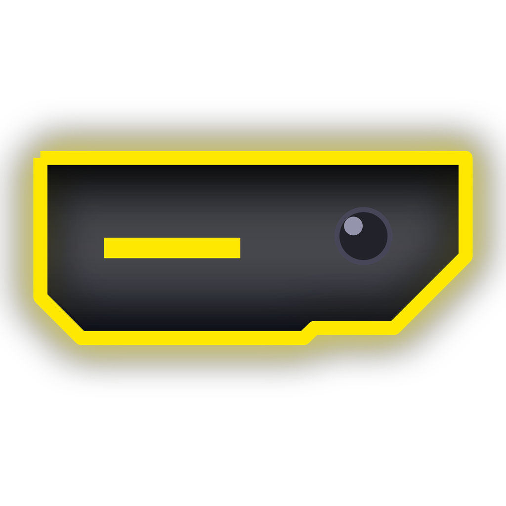

<div align="center">



# Dynamic Notch

A notch for Windows: live activity at the top of the screen, a control center under it, and a search that gets things done.

[](https://github.com/Prism99-collab/DynamicNotch/releases/latest)
[](#requirements)
[](LICENSE)

</div>

## Install

Download the installer from the [latest release](https://github.com/Prism99-collab/DynamicNotch/releases/latest):
`x64` for Intel and AMD PCs, `arm64` for Snapdragon PCs. If you're not sure, use `x64`. No admin rights needed.

The app isn't code-signed yet, so Windows may warn about an unknown publisher: choose **More info → Run anyway**.
Checksums are in `SHA256SUMS.txt`.

To uninstall: **Settings → Apps → Installed apps → Dynamic Notch**.

## How it works

The notch is a thin bar at the top of the screen. It grows when something happens (music, a call, a timer, a
download, a notification) and stays out of the way the rest of the time: clicks pass through it, it slims down over
maximized windows, and it hides in full screen and in games.

Push the pointer against the top edge, press <kbd>Win</kbd>+<kbd>Alt</kbd>+<kbd>N</kbd> or click the tray icon to
open the control center, then swipe between its pages:

| Page | |
|---|---|
| Home | Now playing, Wi-Fi, Bluetooth, focus, volume and app mixer, brightness |
| System | CPU, memory, disk, battery, network and downloads |
| Tools | Timer, snip, keep awake and quick shortcuts |
| Clipboard & Files | Shelf, clipboard history, recent downloads and screenshots |
| Smart | Battery, connection and break reminders, meeting mode |
| Settings | Every option |

### Search

Press <kbd>Alt</kbd>+<kbd>Space</kbd>, click the magnifier, or just start typing while the notch is open.

It looks through your apps, settings, open windows, clipboard history and the files on every drive of your PC.
Apps come first, then everything else. It also remembers what you pick, so the thing you want tends to be on top
next time. Right-click any result for more options, like opening the folder it's in or copying its path.

It understands short instructions too:

```
remind me to call mum at 6        timer 25            focus for 45 min
volume 30 and dark mode           turn off bluetooth  shut down in an hour
15% of 80                         5 km in miles       time in tokyo
```

Each instruction shows what it will do, and nothing happens until you press Enter. Everything runs on your PC,
except web searches and questions you choose to send to an AI assistant.

If you keep your desktop icons hidden, the search shows your desktop instead, so nothing gets lost.
You can change the shortcut and what the search looks through in **Preferences → Search**.

### Also

- **Shelf**: drop files, pictures or text on the notch and drag them out later.
- **Clipboard history** with pins and pictures.
- **Game mode**: a small live FPS counter.
- **Themes** and a colour editor.
- **Companion**: an optional little character that sits on a swing under the notch.
- **Touch and pen** gestures.

## Requirements

Windows 10 (version 2004 or later) or Windows 11, on x64 or ARM64.

## Troubleshooting

- **Can't see it:** push the pointer against the top edge or press <kbd>Win</kbd>+<kbd>Alt</kbd>+<kbd>N</kbd>.
- **Something's wrong:** attach `%APPDATA%\DynamicNotch\app.log` and `error.log` to an
  [issue](https://github.com/Prism99-collab/DynamicNotch/issues).
- **Reset settings:** exit from the tray icon, delete `%APPDATA%\DynamicNotch\settings.json`, then open it again.

## Building

Requires the [.NET 10 SDK](https://dotnet.microsoft.com/download) and [Inno Setup 6](https://jrsoftware.org/isinfo.php).

```powershell
./scripts/build.ps1                     # installers in ./artifacts
dotnet run --project src/DynamicNotch   # run for development
```

Pushing a `v*` tag builds the installers and publishes a release.

## Privacy

No account, no ads, no telemetry. See the [privacy policy](PRIVACY.md).

## License

The code is under the [MIT license](LICENSE). The name, logo and companion are covered by
[TRADEMARKS.md](TRADEMARKS.md). Open-source components are listed in [THIRD-PARTY-NOTICES.md](THIRD-PARTY-NOTICES.md).
Other product names belong to their owners.
