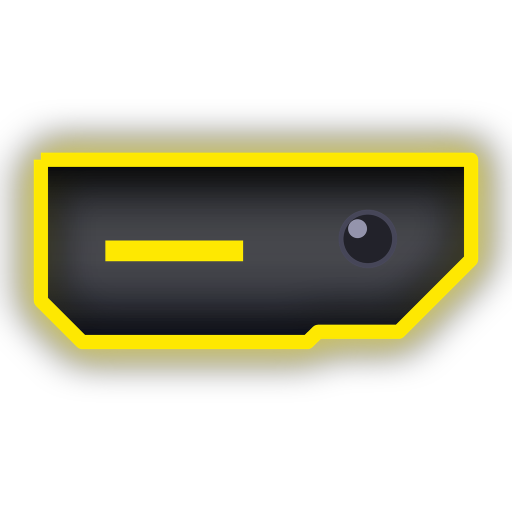

<div align="center">



# Dynamic Notch

**A smooth, Dynamic-Island-style notch and control center for Windows.**
Live activities, smart alerts, quick controls — and it stays out of your way.

[](https://github.com/Prism99-collab/DynamicNotch/releases/latest)
[](#requirements)
[](LICENSE)

</div>

---

## Download & install

1. Open the **[latest release](https://github.com/Prism99-collab/DynamicNotch/releases/latest)**.
2. Download the installer for your PC:

   | Your laptop / PC | File |
   |---|---|
   | **Intel or AMD** (Lenovo, HP, Dell, Asus, Acer, MSI, …) — *most PCs* | `DynamicNotch-Setup-x.y.z-x64.exe` |
   | **Snapdragon / ARM** (Surface Pro X & 11, Copilot+ ARM laptops) | `DynamicNotch-Setup-x.y.z-arm64.exe` |

   Not sure? Take **x64** — it also runs on ARM PCs.
3. Run it and click **Next → Install**. No administrator rights needed, nothing else to install.

> **"Windows protected your PC"?** The app isn't code-signed yet (certificates cost money), so SmartScreen
> may warn about an unknown publisher. Click **More info → Run anyway**. You can check the download against
> `SHA256SUMS.txt` on the release page.

The notch appears at the top of your screen, says hello on its first start, and starts automatically when you sign in.
It's minimal by default (a thin bar at the top edge): push the mouse against the top edge or press <kbd>Win</kbd>+<kbd>Alt</kbd>+<kbd>N</kbd> to open it.
To remove it: **Settings → Apps → Installed apps → Dynamic Notch → Uninstall** (removes everything, including its startup entry).

## Features

**Stays out of your way**
- Minimal by default: a thin bar that only grows when something is happening.
- Click-through: browser tabs and desktop icons under it keep working.
- Over a maximized window it steps aside into a slim bar with a thin glowing line in the song's (or timer's) colour,
  and fades away when your mouse heads for a tab underneath. Pushing against the top edge still opens it.
- Hides in full-screen games, videos and presentations.

**Smooth** — animations run at your screen's real refresh rate (144 / 180 / 240 Hz), and nothing slow ever runs
while the notch is moving.

**Live activities** — music (album art + visualizer tinted with the cover's colours), calls (Discord, Teams, Zoom, WhatsApp, Meet…
with a timer and bars that move with your voice), Pomodoro timer, downloads with real progress, Focus.
Two at once? The second one splits off into its own little island. Lots at once? Pick what the notch shows from the switcher
on Home — every playing tab or app gets its own chip.

**File shelf** — drag a file, picture or text up to the notch to keep it; drag it back out into any app later
(Excel and Word get the picture or text itself, folders and chats get the file), or copy it for Ctrl+V.

**Touch & pen** — on a touch screen, pull the notch down to open it (it follows your finger), swipe up to close, swipe
sideways on it to switch what it shows.

**Game mode** — in a game the notch is just a tiny live FPS counter, for any game.

**Control center** — hover the top edge (or press <kbd>Win</kbd>+<kbd>Alt</kbd>+<kbd>N</kbd>) and swipe between pages:

| Page | What's on it |
|---|---|
| **Home** | Now playing with seek and a volume slider for just the playing app, Wi-Fi, Bluetooth, Airplane, Focus, Mic, Power mode, volume + output / input picker and a per-app mixer, laptop and external monitor brightness |
| **System** | CPU / memory / disk / battery rings, download / upload speed, downloads with real progress, ping & signal, battery health and power draw |
| **Tools** | Pomodoro focus timer (focus / break, rounds, scroll to adjust), Snip, Keep awake, Clipboard history, Files, Terminal, Task Manager, Calculator, Lock, Sleep |
| **Clipboard & Files** | The shelf, recently copied text (click to copy again), newest downloads & screenshots — drag them straight into any app |
| **Smart** | Battery-drain warnings, shaky-connection alerts, charge reminder, Downloads tidy-up, break reminder, optional meeting mode |
| **Settings** | Every option as a switch |

**Smart, clickable alerts** — notifications (Teams, WhatsApp, Outlook…) with a short ringtone at your volume, apps asking for attention,
error and warning dialogs from any app, downloads (finished or failed), screenshots, USB drives, Wi-Fi, Bluetooth, low battery,
Caps Lock, copied text. Each glows in its app's colour, pulses for new things, shakes for problems, gives a tiny shiver when
something didn't work, and opens the right thing when clicked (an error alert also copies its message). Hover to keep one on
screen, scroll to adjust volume, right-click to dismiss.

**Focus** — holds notifications while you work, then shows what you missed.

**Light on resources** — event-driven, about 1 % of one CPU core when idle, with an automatic battery mode when unplugged.

## Using it

| Action | How |
|---|---|
| Open the control center | Push the mouse against the very top edge over the notch, press <kbd>Win</kbd>+<kbd>Alt</kbd>+<kbd>N</kbd>, or click the tray icon |
| Change page | Drag sideways, swipe two fingers on the touchpad, <kbd>Shift</kbd>+scroll, or click the dots |
| Settings for a toggle | Right-click it |
| Options / Exit | Right-click the tray icon (Exit keeps it closed until you open it again or restart the PC) |

## Requirements

- Windows 11, or Windows 10 version 2004 or later (designed for Windows 11 — on Windows 10 a few icons may look slightly different)
- Any x64 (Intel / AMD) or ARM64 PC — laptops and desktops; features adapt to the hardware (no battery, no brightness control, no Bluetooth… are all fine)

## Privacy

Everything stays on your PC. The notch has no telemetry and no account. It only reads what it shows you
(media info, notifications, battery, network). Text copied from password managers is never recorded, and the
clipboard history lives in memory only. The connection check pings `1.1.1.1` while the System page is open
or the "Bad connection" helper is on.

## Troubleshooting

- **The notch didn't appear** — it's a thin bar at the top edge by default: push the mouse against the top edge or press
  <kbd>Win</kbd>+<kbd>Alt</kbd>+<kbd>N</kbd>. Still nothing? Open *Dynamic Notch* from the Start menu; if it can't start it now
  says why. Check *Settings → Start with Windows* is on.
- **Something looks wrong** — logs are in `%APPDATA%\DynamicNotch\app.log` and `error.log`; please attach them to an [issue](https://github.com/Prism99-collab/DynamicNotch/issues).
- **Reset settings** — exit the notch from its tray icon, delete `%APPDATA%\DynamicNotch\settings.json`, and open it again.

## Building from source

Requirements: [.NET 10 SDK](https://dotnet.microsoft.com/download) and [Inno Setup 6](https://jrsoftware.org/isinfo.php) (`winget install JRSoftware.InnoSetup`).

```powershell
git clone https://github.com/Prism99-collab/DynamicNotch.git
cd DynamicNotch
./scripts/build.ps1            # installers + checksums in ./artifacts
dotnet run --project src/DynamicNotch   # or just run it for development
```

Pushing a tag like `v1.1.0` builds both installers on GitHub Actions and publishes them as a release.

### Project layout

```
src/DynamicNotch/
  NotchWindow.xaml(.cs)   window, shape state machine, spring physics, hover / hotkey, click-through
  NotchWindow.*.cs        Home, Pages, Alerts, Smart, Motion
  Services/               media, audio (per-app volume, devices), radios, Bluetooth, laptop and monitor brightness,
                          power, notifications + sound, privacy, files, system monitor, focus, startup / keep-alive
  Controls/               spring, sliders, rings, toggles, battery icon, dark tray menu
installer/                Inno Setup script
scripts/                  build and dev-install scripts
```

## License

[MIT](LICENSE) © 2026 Prism99-collab
